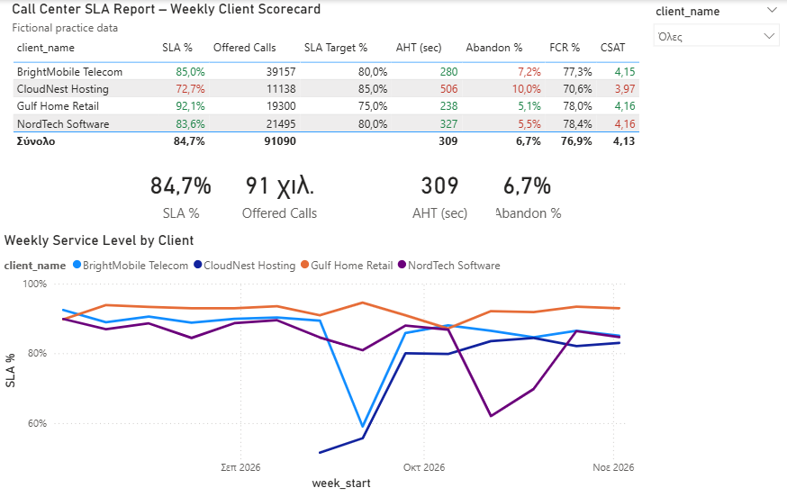
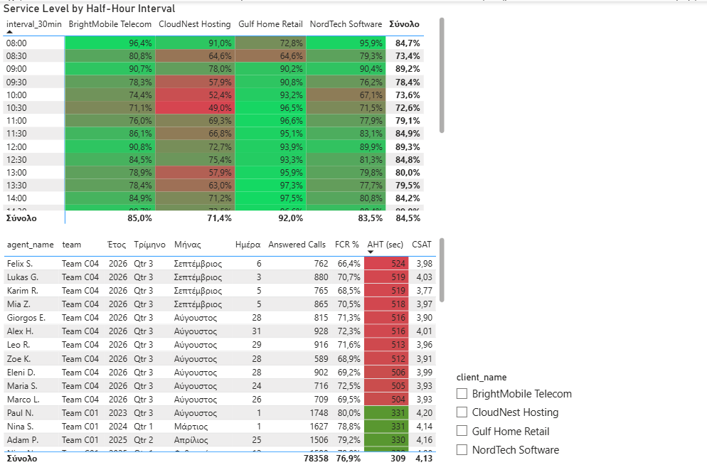

# Call Center SLA Reporting (SQL + Power BI)

Weekly contractual SLA reporting for a multi-client call center (BPO): SQL analysis in SQLite, an automated Power BI report that loads daily CSV exports from a folder, and root-cause analysis of missed service levels.

> **Fictional data.** The clients, agents and calls are synthetic and were generated for practice. They do not describe any real company.




*Scorecard shown after the refresh test (03/08 – 08/11/2026, 91,090 calls). Intraday & Agents page shown for 03/08 – 01/11/2026.*

## Business questions

1. Is each client meeting its contractual targets (Service Level, abandonment, AHT, CSAT)?
2. In which weeks were targets missed, and why: more calls than usual (demand) or fewer agents / slower handling (supply)?
3. At which times of day does service break down?
4. Can the weekly report refresh automatically when a new day of data arrives?

## Data

- 4 clients (German, English and Arabic queues), 49 agents, 03/08/2026 – 08/11/2026.
- `daily_exports/`: one CSV per day as exported by the phone system (1 row = 1 call: wait time, answered/abandoned, agent, talk/hold/after-call work, first-contact resolution, CSAT survey score).
- `reference/clients_sla.csv`: contractual targets per client (e.g. 80% of calls answered within 20 seconds).
- `reference/agents.csv`: agent, team, hire date.
- Generated with `data/generate_data.py` (fixed seed, reproducible). Column definitions are in `data/README_DATA.md`.

## Method

1. **SQLite + DBeaver.** Imported the call history (84,077 calls, 13 weeks) with empty values as NULL, so abandoned calls do not distort averages. Checked row counts and NULLs before any analysis.
2. **SQL KPIs** (`sql/`):
   - Client scorecard against contract targets (`JOIN`, `CASE WHEN`, `AVG` ignoring NULLs).
   - Weekly Service Level per client with a CTE and a Monday week start.
   - Staffing analysis: distinct agents on shift per weekday and calls per agent.
3. **Power BI.**
   - Power Query *Folder* connector combines all daily CSVs. Types are set with an English (US) locale, so decimals and timestamps parse correctly on Greek Windows.
   - Star schema: `calls` fact table, `clients` and `agents` dimensions, one-to-many relationships.
   - DAX measures (`powerbi/measures.dax`): SLA %, Abandon %, AHT, ASA, FCR %, CSAT, targets with `SELECTEDVALUE`, and green/red status per KPI. Lower-is-better KPIs (Abandon, AHT) are compared with `<=`.
   - Pages: Client Scorecard (KPI cards, colored scorecard, weekly SLA trend) and Intraday & Agents (half-hour heatmap, agent table).
4. **Reconciliation.** Power BI KPIs matched the SQL scorecard exactly for all four clients.
5. **Refresh test.** Added 7 new daily files to the folder and clicked Refresh. Offered calls went from 84,077 to 91,090 with no manual steps.

## Key findings (03/08 – 01/11/2026, 13 weeks)

| Client | Service Level (target) | Abandon % (max) | AHT sec (max) | CSAT (min) |
|---|---|---|---|---|
| BrightMobile Telecom | 85.0% (80%) | 7.2% (6%) | 280 (300) | 4.15 (4.0) |
| CloudNest Hosting | 71.4% (85%) | 10.6% (4%) | 514 (480) | 3.95 (4.3) |
| Gulf Home Retail | 92.0% (75%) | 5.2% (7%) | 238 (250) | 4.16 (4.0) |
| NordTech Software | 83.5% (80%) | 5.6% (5%) | 328 (340) | 4.15 (4.2) |

- **NordTech, weeks of 12/10 and 19/10: staffing shortfall.**
  - Service Level fell to 62.0% and 69.8% (target 80%) while volume was normal (271 and 259 calls per weekday vs about 265).
  - AHT was unchanged (327 and 325 sec).
  - What changed: agents on shift dropped from about 10.5 to 7.2, so each agent handled 31.7 calls per day instead of about 24. Service recovered to 86.4% when staffing returned to 10.8.
- **BrightMobile, week of 21/09: demand spike.**
  - 759 calls per weekday vs about 450 (+68%) with the usual 13.8 agents. Service Level was 59.0% and abandonment 20.4%.
  - Volume has also grown from 433 to 517 calls per weekday (August to late October) with flat headcount. Service Level is drifting from about 90% toward the 80% target, an early warning to add capacity.
- **CloudNest, new client since 14/09: launch and learning curve.**
  - First two weeks: 322 calls per weekday, Service Level 51.5% and 55.6%.
  - After the launch peak, AHT stayed at 506–530 sec (target 480) because the whole team was hired in August–September. Service Level stayed at 79.8–84.4%, below the 85% target.
  - AHT fell to 472 sec (weekdays) in the week of 26/10.
- **Intraday.**
  - CloudNest's worst intervals are 09:30–10:30 (Service Level 49–58%).
  - Gulf Home Retail misses its 75% target only at 08:00–08:30 (64.6–72.8%) because its demand peaks earlier.
  - Shift start times should follow the half-hour demand curve.

## Limitations

- Synthetic data: patterns were built in to practice root-cause analysis.
- "Agents on shift" is inferred from who answered calls. A real analysis would use workforce-management data (scheduled and logged-in hours).
- Service Level definitions differ between contracts (e.g. excluding very short abandons). Here SLA = calls answered within the threshold ÷ all offered calls.
- AHT is compared only against each client's own target, never across clients with different call types.
- The findings are associations in the data. Staffing and demand explain the misses here, but other causes cannot be ruled out without more data.

## SQL queries

| File | What it answers |
|---|---|
| `sql/01_client_scorecard.sql` | KPIs per client vs contract targets |
| `sql/02_weekly_sla.sql` | Weekly Service Level and abandonment per client, OK/MISS |
| `sql/03_staffing.sql` | Agents on shift, calls per agent and AHT per week |

## Repository structure

```
call-center-sla-reporting/
├── README.md
├── dashboard_scorecard.png
├── dashboard_intraday_agents.png
├── call_center_sla.pbix
├── powerbi/
│   └── measures.dax
├── sql/
│   ├── 01_client_scorecard.sql
│   ├── 02_weekly_sla.sql
│   └── 03_staffing.sql
└── data/
    ├── README_DATA.md
    ├── generate_data.py
    └── reference/
        ├── clients_sla.csv
        └── agents.csv
```

To recreate the call data (98 daily CSV files and `calls_history.csv`), run `python generate_data.py` inside `data/`. The fixed seed produces exactly the same files used in this analysis.

## Tools

SQL (SQLite, DBeaver) · Power BI Desktop (Power Query, DAX, data modeling) · Python (data generation)
